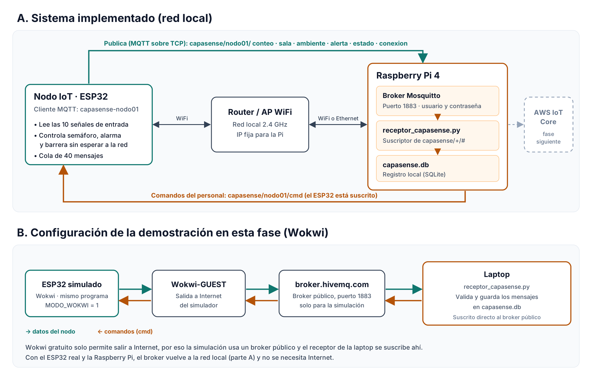

# CapaSense

Sistema IoT de control de acceso y capacidad para salas de espera de centros de salud.
Proyecto del curso CC3108 Internet of Things, Universidad del Valle de Guatemala, ciclo 2 de 2026.

**Integrantes:** Estuardo Sebastian García de León (25057) · Andrés Castro Morales (25039) · David Alfonso Díaz Muralles (25314)

CapaSense cuenta a las personas que entran y salen de la sala de espera, compara la ocupación con una capacidad máxima de 20 personas y responde por sí solo con un semáforo, una alarma y una barrera. El nodo ESP32 envía sus datos por MQTT a un broker Mosquitto en la red local, donde un programa en Python los valida y los guarda.



## Contenido del repositorio

| Archivo | Qué es |
| --- | --- |
| `capasense_nodo/capasense_nodo.ino` | Programa del nodo ESP32 (Arduino). Corre en Wokwi y en el circuito real |
| `raspberry/receptor_capasense.py` | Programa receptor: se suscribe a los temas, valida cada mensaje y lo guarda en SQLite |
| `raspberry/prueba_receptor.py` | Envía mensajes de prueba, con errores a propósito, para comprobar el receptor sin el ESP32 |
| `raspberry/mosquitto.conf` | Configuración del broker Mosquitto |
| `raspberry/requirements.txt` | Librería de Python que usa el receptor (paho-mqtt 2.x) |
| `wokwi/libraries.txt` | Librerías que necesita el proyecto en Wokwi |
| `wokwi/diagram.json` | Circuito del simulador Wokwi |
| `docs/` | Diagrama eléctrico y diagrama de comunicación |

## Temas MQTT

| Tema | Quién publica | Envío |
| --- | --- | --- |
| `capasense/nodo01/conteo` | ESP32 | Cada entrada, salida, corrección o anulación |
| `capasense/nodo01/sala` | ESP32 | Cuando cambia la puerta o el movimiento |
| `capasense/nodo01/ambiente` | ESP32 | Cada 30 s (temperatura, humedad, luz, ruido, voltaje) |
| `capasense/nodo01/alerta` | ESP32 | Cuando la fuente del servomotor baja de 4.8 V o se recupera |
| `capasense/nodo01/estado` | ESP32 | Cada 60 s |
| `capasense/nodo01/conexion` | ESP32 y broker (última voluntad) | Al conectarse o desconectarse el nodo |
| `capasense/nodo01/cmd` | Personal | Comandos `anular`, `restaurar` y `ajustar` |

El catálogo completo de mensajes está en el informe de la Fase 03.

## Cómo ejecutarlo

### 1. Nodo ESP32

1. Abrir `capasense_nodo/capasense_nodo.ino` en el Arduino IDE o pegarlo en Wokwi.
2. Instalar las librerías de `wokwi/libraries.txt`.
3. En la sección de configuración del programa:
   - `#define MODO_WOKWI 1` para el simulador. Usa la red `Wokwi-GUEST` y el broker público `broker.hivemq.com`.
   - `#define MODO_WOKWI 0` para el circuito real. Escribir el nombre y la clave de la red WiFi, la IP del broker y el usuario y la contraseña MQTT.

### 2. Broker Mosquitto

Raspberry Pi:

```bash
sudo apt update
sudo apt install -y mosquitto mosquitto-clients
sudo mosquitto_passwd -c /etc/mosquitto/passwd capasense
sudo chown mosquitto:mosquitto /etc/mosquitto/passwd
sudo chmod 600 /etc/mosquitto/passwd
sudo cp raspberry/mosquitto.conf /etc/mosquitto/conf.d/capasense.conf
sudo systemctl restart mosquitto
```

Windows (laptop que sustituye a la Pi): copiar `mosquitto.conf` a `C:\mosquitto`, cambiar la línea `password_file` por `C:\mosquitto\passwd` y, en un Símbolo del sistema como administrador:

```bat
cd "C:\Program Files\mosquitto"
mosquitto_passwd -c C:\mosquitto\passwd capasense
net stop mosquitto
mosquitto -c C:\mosquitto\mosquitto.conf -v
```

El bloque `puente-wokwi` de `mosquitto.conf` intenta traer los mensajes del broker público al broker local. En la Fase 03 no logró conectarse, así que para la demostración con Wokwi el receptor se suscribe directo al broker público (ver abajo). Con el ESP32 real el puente se comenta.

### 3. Programa receptor

```bash
cd raspberry
python3 -m venv venv
source venv/bin/activate          # Windows: venv\Scripts\activate
pip install -r requirements.txt
python receptor_capasense.py --host localhost --user capasense --password CLAVE
```

Para la demostración con Wokwi, sin broker local:

```bash
python receptor_capasense.py --host broker.hivemq.com
```

Al cerrarlo con Ctrl+C muestra un resumen de mensajes por tema, el intervalo promedio y los mensajes perdidos. Todo queda guardado en `capasense.db`.

### 4. Enviar un comando al nodo

```bash
mosquitto_pub -h localhost -u capasense -P CLAVE -t capasense/nodo01/cmd -m '{"accion":"ajustar","ocupacion":19}'
```

En el Símbolo del sistema de Windows: `-m "{\"accion\":\"ajustar\",\"ocupacion\":19}"`. En la demostración con Wokwi se usa `-h broker.hivemq.com` sin `-u` ni `-P`.

## Pines del ESP32

| Señal | GPIO |
| --- | --- |
| HC-SR04 TRIG / ECHO (con divisor) | 26 / 27 |
| Barrera IR QT30CM | 33 |
| Reed switch | 25 |
| PIR HC-SR501 | 32 |
| DHT22 | 14 |
| LDR / sonido / voltaje FZ0430 | 34 / 35 / 36 |
| RTC SDA / SCL | 21 / 22 |
| Pulsador S2 / S3 | 13 / 23 |
| LED verde / amarillo / rojo | 16 / 17 / 4 |
| Buzzer | 18 |
| Servomotor | 19 |
